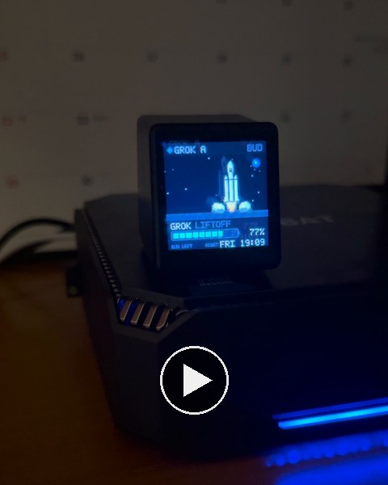
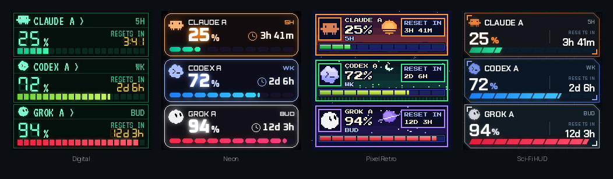

<h1 align="center">TokenTV</h1>

  
  
  
  

<b>약 5달러 Wi-Fi 책상 시계에 Claude·Codex 사용 한도를 띄웁니다. 펌웨어는 그대로예요.</b>

 

**새 화면 Arcade:** 캐릭터마다 그림이 곧 게이지이고, 아래 줄에 지금 하는 일, 남은 사용량 배터리, 초기화 시각이 나옵니다.

**구경하기:** [라이브 데모](https://token-tv.vercel.app) 또는 `npx token-tv demo`, 시계·로그인 없이 바로.  
**설치하기:** 계속 켜 두는 컴퓨터에서 `npx token-tv start`(또는 `uvx token-tv start`). 로그인된 도구와 같은 와이파이의 시계를 찾고, 백그라운드에서 계속 돌며, 대시보드를 엽니다. AI에게 *"TokenTV 설정해줘"* 라고 해도 됩니다([AGENTS.md](AGENTS.md)).

**필요한 것:**
- GeekMagic SmallTV 시계, SD_PRO 또는 Ultra([호환 시계](docs/hardware-compatibility.md)).
- 그 컴퓨터에 로그인해 둔 Claude Code, Codex, Grok CLI 중 하나. 브라우저 로그인만으로는 안 됩니다([설정](docs/setup.ko.md)).
- `npx`를 쓸 [Node](https://nodejs.org/). Python이 필요하면 런처가 알아서 받아 옵니다.

로그인 정보는 내 컴퓨터에만 있습니다: TokenTV는 각 서비스의 CLI가 저장한 로그인으로 사용량만 묻고, 시계는 그림만 받습니다.

**업데이트:** `npx token-tv update`(또는 `uvx token-tv update`), 설정과 로그인은 그대로입니다.  
**내 화면 만들기:** [Game Boy 예제](examples/gameboy)에서 시작해 AI에게 바꿔 달라고 하세요([가이드](docs/clock-faces.md)).  
자세히: [설정과 옵션](docs/setup.ko.md) · [CodexBar(Copilot, Antigravity)](docs/codexbar.md) · [애플워치](docs/apple-watch.md) · [English](README.md)
