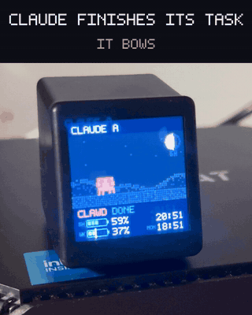
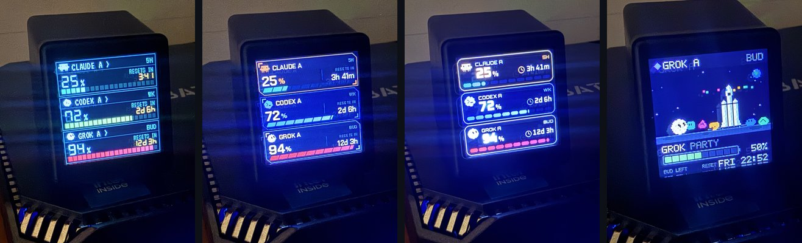
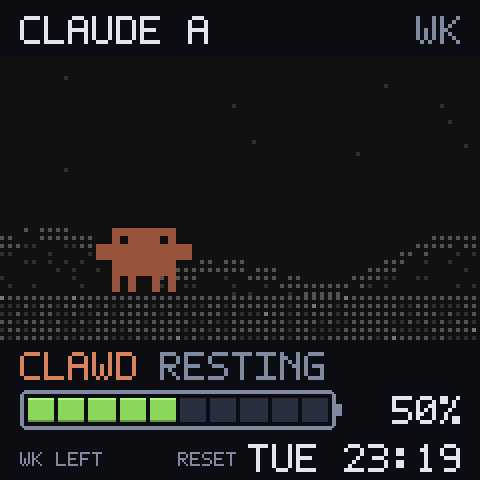
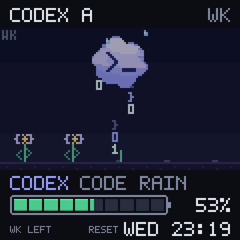
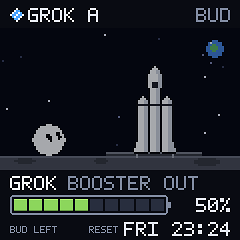
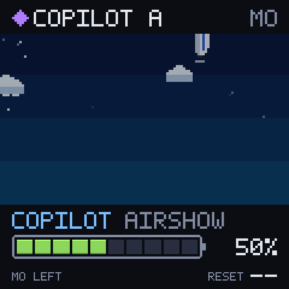
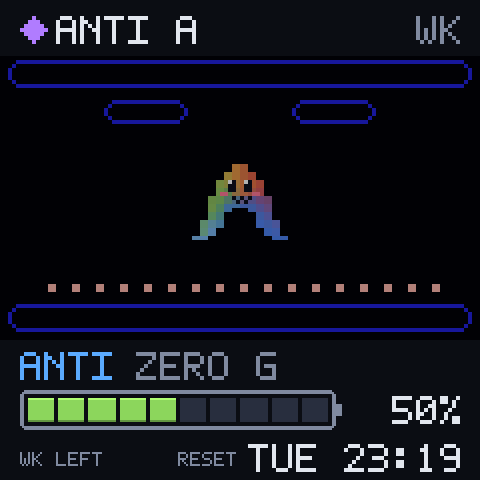

<h1 align="center">TokenTV</h1>

  
  
  
  

약 5달러 알리익스프레스 시계(GeekMagic SmallTV)가 Claude Code와 Codex의 픽셀 펫이 됩니다. 에이전트에 반응하고 사용 한도를 보여 줍니다. 펌웨어는 그대로예요.

**구경하기:** [라이브 데모](https://click6067-ship-it.github.io/token-tv/) 또는 `npx token-tv demo`, 시계·로그인 없이 바로.  
**설치하기:** 계속 켜 두는 컴퓨터에서 `npx token-tv start`(또는 `uvx token-tv start`). 같은 와이파이의 시계와 로그인된 도구를 찾습니다. AI에게 *"TokenTV 설정해줘"* 라고 해도 됩니다([AGENTS.md](AGENTS.md)).

**Claude Code 모드:** Claude가 허락을 기다리면 Clawd가 손을 들고, 위험한 명령에는 법정을 열고, 소리치면 삐집니다([설정 방법](docs/claude-code-mod.md)).  
**Arcade:** 코딩하는 동안 봇들도 바쁩니다. Codex는 코드 비로 꽃밭을 키우고, Grok은 로켓에 연료를 넣고, Copilot과 Anti도 함께합니다.

    

**비밀 장면:** 정해진 시간에만, 혹은 거의 나오지 않는 장면들. 얼마나 있는지는 [도감](https://click6067-ship-it.github.io/token-tv/collection/)에서.

*귀여움이 곧 기능입니다.* 아이디어와 PR 환영합니다.  
**더 보기:** [영상](https://youtube.com/shorts/FN5DLILYiI0) · [TokenTV 소개된 곳](docs/in-the-wild.md) · [어떤 시계를 살까](docs/hardware-compatibility.md#buying-a-clock)
