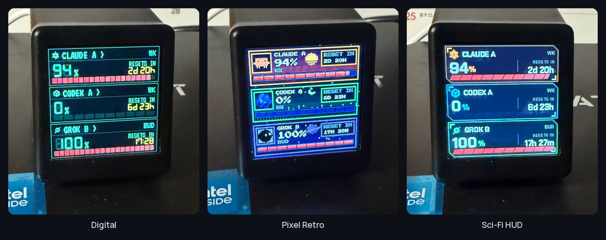
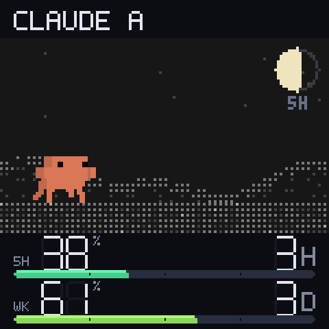
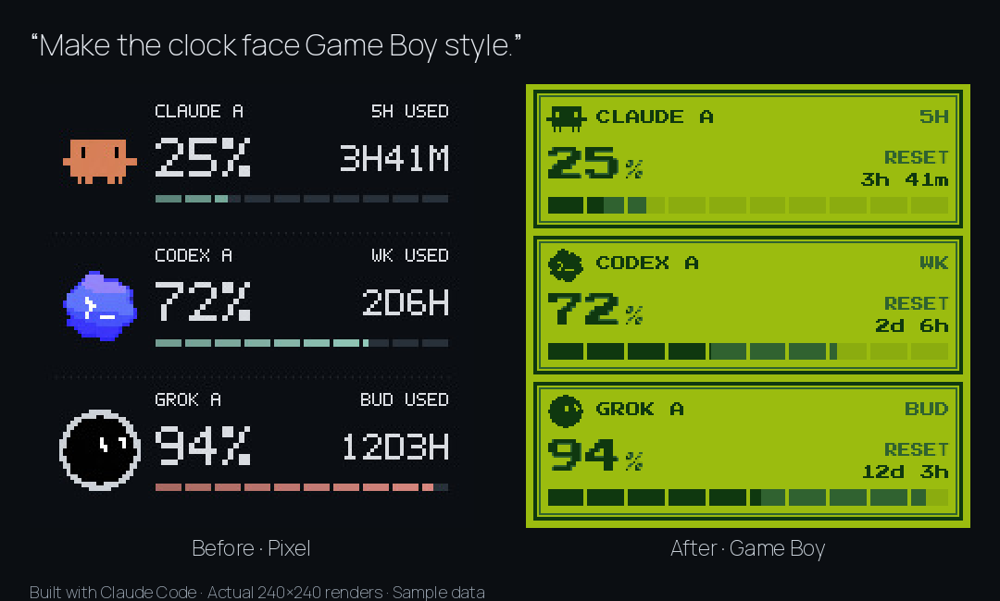

<h1 align="center">TokenTV</h1>

  
  
  
  

약 5달러 Wi-Fi 책상 시계에 Claude·Codex 사용 한도(그리고 Grok, CodexBar를 거쳐 Copilot·Antigravity)를 띄웁니다. 펌웨어는 그대로예요.  
**새 화면 Arcade:** 캐릭터마다 그림이 곧 게이지인 움직이는 화면입니다. 드문 장면 몇 개는 그 순간이 실제로 찾아올 때만 열립니다.  
**구경하기:** [라이브 데모](https://token-tv.vercel.app), `npx token-tv demo` 또는 `uvx token-tv demo`, 시계·로그인 없이 바로.

**필요한 것:**
- 컴퓨터와 같은 와이파이에 연결된 GeekMagic SmallTV 시계(SD_PRO 또는 Ultra, [호환 시계](docs/hardware-compatibility.md)).
- Claude Code, Codex, Grok CLI 중 하나를 설치하고 로그인해 둔, 계속 켜 두는 컴퓨터. 브라우저에서 claude.ai나 chatgpt.com에 로그인한 것만으로는 안 됩니다. [Claude Code](https://code.claude.com/docs/ko/quickstart)나 Codex(`npm install -g @openai/codex`)를 설치해 같은 계정으로 로그인하세요.
- `npx`를 쓸 [Node](https://nodejs.org/). 다른 것은 필요 없습니다. Python이 필요하면 런처가 알아서 받아 옵니다.

Windows에서는 claude·codex가 로그인된 쪽(Windows 또는 WSL)에서 실행하세요. Node를 설치한 Windows에서 바로 돌리는 게 가장 간단하고, WSL은 마지막 터미널을 닫으면 곧 꺼집니다.  
컴퓨터가 잠자기 상태일 때는 시계가 마지막 그림을 그대로 보여 줍니다. 로그인 정보는 내 컴퓨터에만 있습니다:
TokenTV는 각 서비스의 CLI가 저장한 로그인으로 사용량만 묻고, 시계는 그림만 받습니다.

**설치하기:** Claude·Codex·Grok을 쓰는 컴퓨터에서 `npx token-tv start`(또는 `uvx token-tv start`) 한 줄이면 됩니다. 로그인된 도구와 같은 와이파이의 시계를 스스로 찾고, 원하면 터미널을 닫아도 컴퓨터를 다시 켜도 계속 돌게 해 주며, 대시보드를 엽니다. [라이브 데모](https://token-tv.vercel.app)에서 화면과 도구를 고르면 명령을 만들어 줍니다. AI에게 이 저장소를 주고 *"TokenTV 설정해줘"* 라고 해도 됩니다([AGENTS.md](AGENTS.md)).  
**내 화면 만들기:** 시계 없이 [Game Boy 예제](examples/gameboy)에서 시작해 AI에게 바꿔 달라고 하세요. [가이드](docs/clock-faces.md) · [공유하기](https://github.com/click6067-ship-it/token-tv/issues/new?template=share_a_face.md)  
자세히: [설정](docs/setup.ko.md) · [호환 시계](docs/hardware-compatibility.md) · [CodexBar 연동](docs/codexbar.md) · [애플워치](docs/apple-watch.md) · [English](README.md)  
**새 소식:** 새 화면과 지원 시계는 [릴리스](https://github.com/click6067-ship-it/token-tv/releases)로 나옵니다. 받아 보려면 Watch → Custom → Releases.  

