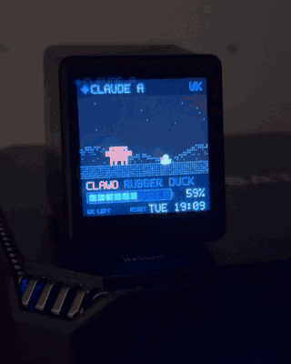
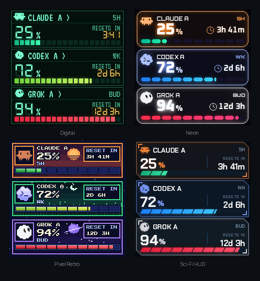

<h1 align="center">TokenTV</h1>

  
  
  
  

  

약 5달러 알리익스프레스 시계(GeekMagic SmallTV)를 AI 사용량 대시보드로 바꿉니다(Claude, Codex, 여러 계정). 펌웨어는 그대로예요.

**라이브 데모:** [token-tv.vercel.app](https://token-tv.vercel.app)  
**유튜브:** [실제 시계에서 16초](https://youtube.com/shorts/FN5DLILYiI0)  
**구경하기:** [라이브 데모](https://token-tv.vercel.app) 또는 `npx token-tv demo`, 시계·로그인 없이 바로.  
**설치하기:** 계속 켜 두는 컴퓨터에서 `npx token-tv start`(또는 `uvx token-tv start`). 로그인된 도구와 같은 와이파이의 시계를 찾고, 백그라운드에서 계속 돌며, 대시보드를 엽니다. AI에게 *"TokenTV 설정해줘"* 라고 해도 됩니다([AGENTS.md](AGENTS.md)).
