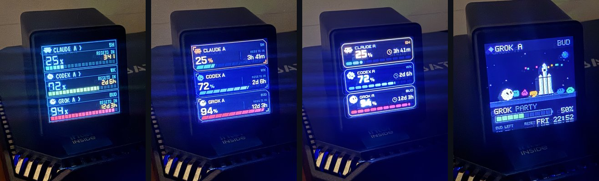
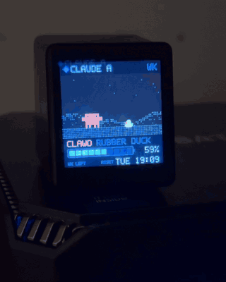
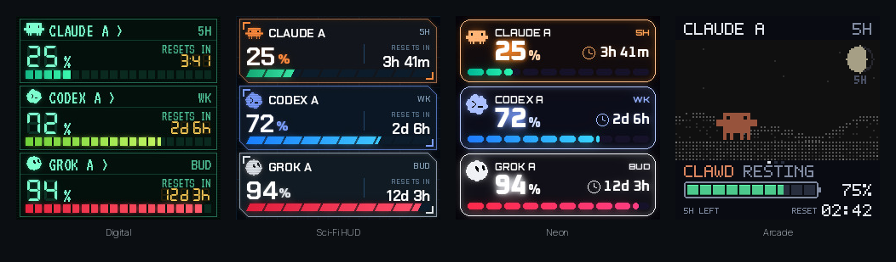
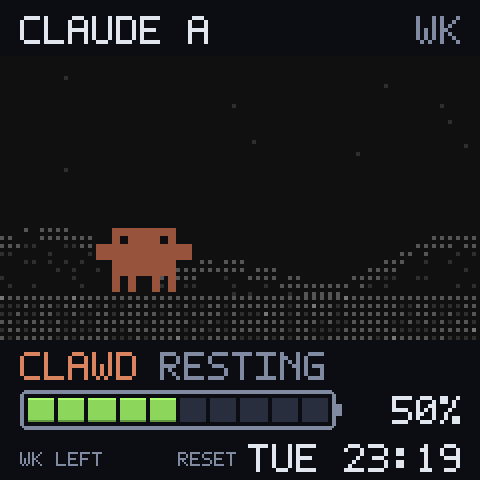
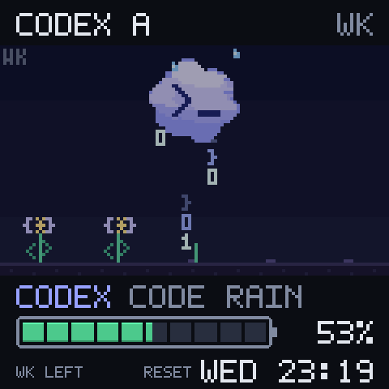
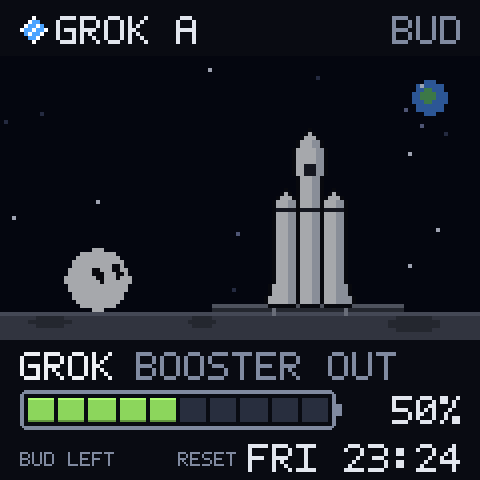
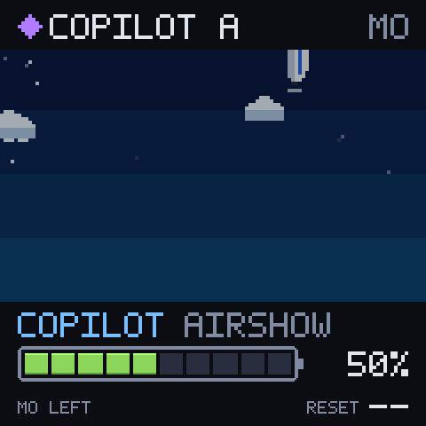
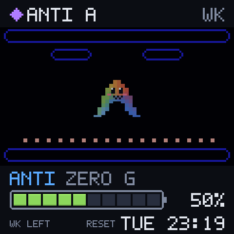

<h1 align="center">TokenTV</h1>

  
  
  
  

 

약 5달러 알리익스프레스 시계(GeekMagic SmallTV)를 AI 사용량 대시보드로 바꿉니다. 펌웨어는 그대로예요.

**라이브 데모:** [token-tv.vercel.app](https://token-tv.vercel.app)  
**유튜브:** [https://www.youtube.com/shorts/FN5DLILYiI0](https://youtube.com/shorts/FN5DLILYiI0)  
**구경하기:** [라이브 데모](https://token-tv.vercel.app) 또는 `npx token-tv demo`, 시계·로그인 없이 바로.  
**설치하기:** 계속 켜 두는 컴퓨터에서 `npx token-tv start`(또는 `uvx token-tv start`). 로그인된 도구와 같은 와이파이의 시계를 찾고, 백그라운드에서 계속 돌며, 대시보드를 엽니다. AI에게 *"TokenTV 설정해줘"* 라고 해도 됩니다([AGENTS.md](AGENTS.md)).

**새 화면 Arcade:** 코딩하는 동안 봇들도 바삐 움직입니다. 예를 들어 Codex는 토큰을 쓰는 동안 코드 비를 뿌려 꽃을 키웁니다. 많이 쓸수록 꽃밭이 가득 찹니다. Clawd는 게임에서처럼 땅을 달리고, Grok은 로켓에 연료를 넣다가 쉴 때는 지구를 올려다봅니다. Copilot과 Anti는 새로 온 친구들입니다.

    

**저마다 다르게 반응합니다.** 한도가 리셋되면 축하하고, 얼마 안 남으면 누군가는 허둥대고 누군가는 초조해합니다. 남은 리셋권은 시계에 표시되고, 만료가 며칠 남으면 빨갛게 알려 줍니다.  
**그리고 비밀 장면이 몇 개 있습니다.** 어떤 건 정해진 시간에만, 어떤 건 봇이 정말 열심히 일한 뒤에만, 어떤 건 거의 나오지 않습니다. 한 번, 잠깐만 나오고, 무엇인지는 말하지 않겠습니다. 소스를 봐도 안 나옵니다. 봉인돼 있거든요. 얼마나 있는지는 [도감](https://token-tv.vercel.app/collection/)에서 볼 수 있습니다.

숫자는 한눈에, 그리고 귀엽게. 새벽 3시에 혼자 코딩해도 봇들이 곁을 지킵니다. 누군가 커피를 타 줄지도 모르죠. 아이디어, 제안, PR 모두 환영입니다. *귀여움이 곧 기능입니다.*
