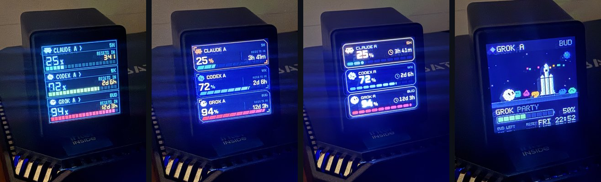
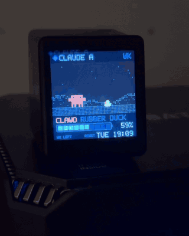
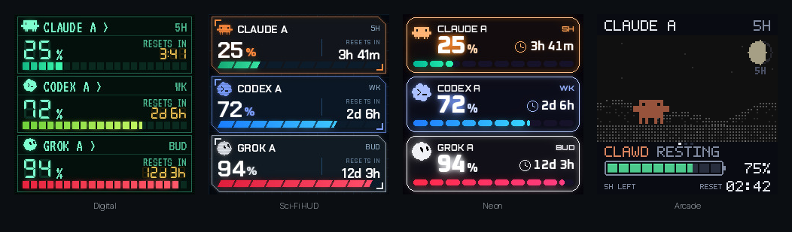
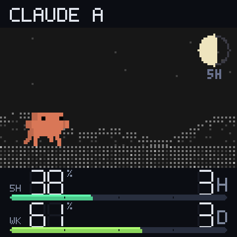

<h1 align="center">TokenTV</h1>

  
  
  
  

 

Turn a ~$5 AliExpress clock (GeekMagic SmallTV) into a physical AI usage dashboard. No firmware flashing.

**Live demo:** [token-tv.vercel.app](https://token-tv.vercel.app)  
**YouTube:** [https://www.youtube.com/shorts/FN5DLILYiI0](https://youtube.com/shorts/FN5DLILYiI0)  
**Try it:** [live demo](https://token-tv.vercel.app) or `npx token-tv demo`, no clock or login needed.  
**Set it up:** run `npx token-tv start` (or `uvx token-tv start`) on a computer that stays on. It finds your signed-in tools and the clock on your Wi-Fi, keeps running in the background and opens your dashboard. Or tell your AI *"Set up TokenTV for me"* ([AGENTS.md](https://github.com/click6067-ship-it/token-tv/blob/main/AGENTS.md)).

