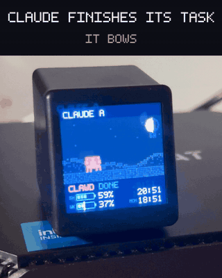
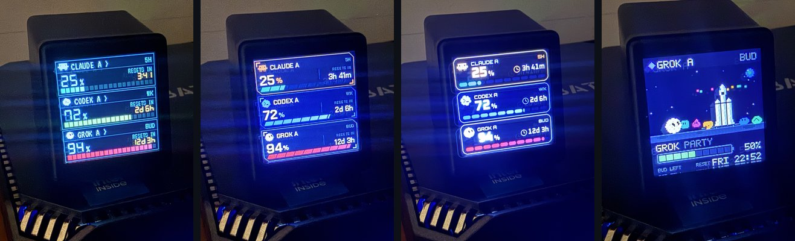
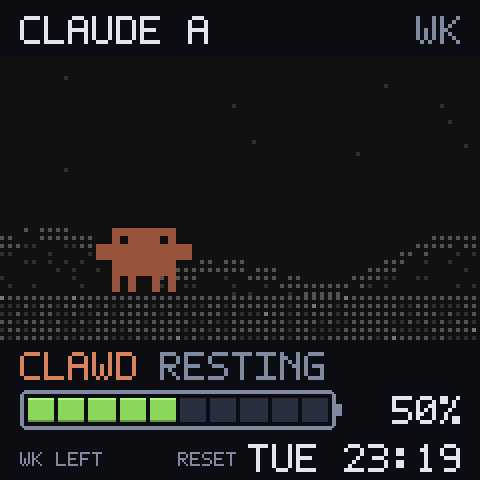
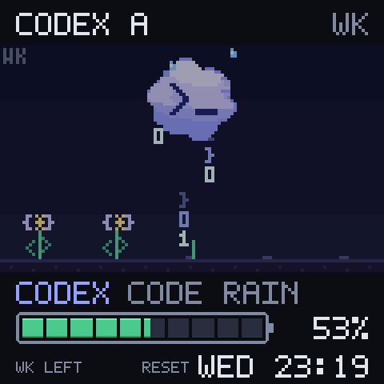
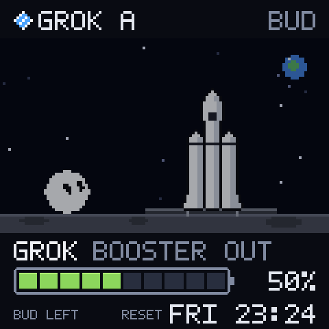
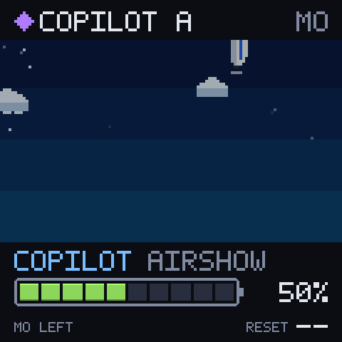
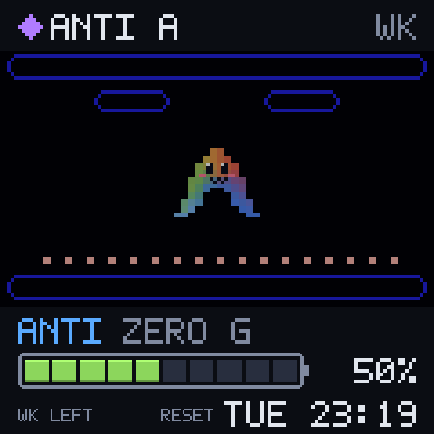

<h1 align="center">TokenTV</h1>

  
  
  
  

Turn a ~$5 AliExpress clock (GeekMagic SmallTV) into pixel pets for Claude Code and Codex. They react to your agents and keep your usage limits in sight. No firmware flashing.

**See every scene:** [the collection](https://click6067-ship-it.github.io/token-tv/collection/), a few still sealed.  
**Try it:** [live demo](https://click6067-ship-it.github.io/token-tv/) or `npx token-tv demo`, no clock or login needed.  
**Set it up:** `npx token-tv start` (or `uvx token-tv start`) on a computer that stays on. It finds the clock on your Wi-Fi and your signed-in tools. Or tell your AI *"Set up TokenTV for me"* ([AGENTS.md](https://github.com/click6067-ship-it/token-tv/blob/main/AGENTS.md)).

**Claude Code mode:** Clawd raises a hand when Claude needs you, holds court over risky commands and sulks when you shout ([set it up](https://github.com/click6067-ship-it/token-tv/blob/main/docs/claude-code-mod.md)).  
**Arcade:** the bots get busy while you code. Codex rains code on its garden, Grok fuels its rocket, and Copilot and Anti join in.

    

**Secret scenes:** some only at certain hours, some almost never.

*Cuteness is a feature.* Ideas and PRs welcome.  
**More:** [video](https://youtube.com/shorts/FN5DLILYiI0) · [TokenTV in the wild](https://github.com/click6067-ship-it/token-tv/blob/main/docs/in-the-wild.md) · [which clock to buy](https://github.com/click6067-ship-it/token-tv/blob/main/docs/hardware-compatibility.md#buying-a-clock)
