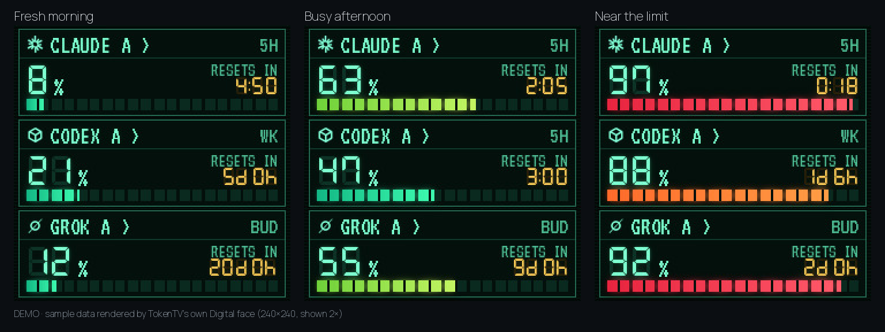
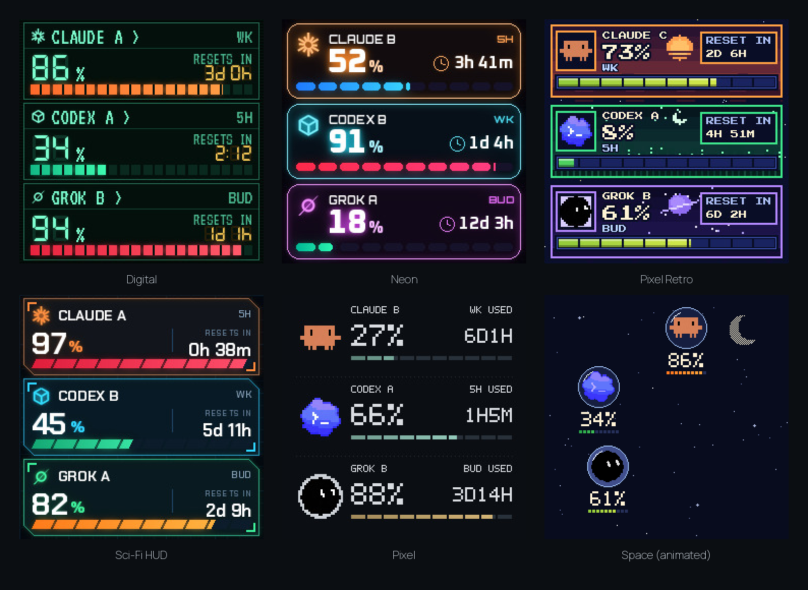

# TokenTV setup and reference

Everything that used to be in the README. Written for people and for AI coding agents; see also [AGENTS.md](../AGENTS.md).

## Quick start

You need a GeekMagic SmallTV (SD_PRO or Ultra) on your Wi-Fi, and a computer that stays on where the official
CLI of each service you use is installed and signed in: Claude Code (`claude`), Codex (`codex`) or Grok (`grok`).
A claude.ai or chatgpt.com login in the browser is not enough: install
[Claude Code](https://code.claude.com/docs/en/quickstart) or Codex (`npm install -g @openai/codex`) and sign in
with the same account. `npx` needs only [Node](https://nodejs.org/): the launcher brings its own Python if it
needs one.

```bash
npx token-tv start          # or: uvx token-tv start
```

With pipx: `pipx install token-tv`, then `pipx ensurepath`, open a new terminal and run `token-tv start`.

`start` finds the Claude, Codex and Grok CLIs that are signed in and asks you to confirm each email, looks for
the clock on your Wi-Fi (or asks for its address, shown on the clock's screen when it starts), asks whether
TokenTV should start with the computer and keep running (only when it first makes the config), then opens the
dashboard at http://127.0.0.1:8787.
Choices on the command line: `--face pixel` (default `arcade`), `--only codex` (or `claude,codex`),
`--device-url 192.168.0.50`. The [live demo](https://token-tv.vercel.app) writes this line for you.
`npx token-tv autostart off` stops the background copy and keeps it from starting with the computer
(`uvx token-tv ...` or `token-tv ...`, the way you started it); `autostart on` sets it up again. On Linux the
background copy keeps running after you log out where the system allows it; TokenTV tells you when it does not.
If the router later gives the clock a new address, TokenTV finds it again on its own. Set up without a clock, run
`start` again once the clock is on the Wi-Fi: it looks for it then (never on its own, since a clock on a shared
Wi-Fi may be someone else's), and `start --device-url 192.168.0.50` adds one any time.

On Windows, run TokenTV on the side where your claude or codex is signed in: Windows itself with Node is simplest,
and WSL stops soon after its last terminal closes. While the computer sleeps, the clock keeps its last picture.

More accounts or more control (written as `token-tv`; put `npx` or `uvx` in front if that is how you run it):

```bash
token-tv demo                 # every clock face with sample data, no login
token-tv setup                # asks for emails (up to 3 per provider) and the clock IP
token-tv doctor --live        # asks each provider now; says what is missing and the fix
token-tv run                  # dashboard at http://127.0.0.1:8787, drives the clock
```

From a clone, `python3 -m venv .venv && .venv/bin/pip install .` gives the same command as `.venv/bin/token-tv`.

<p align="center"></p>

<details>
<summary><b>All the clock faces</b></summary>

<br>



Six of them are above; there are also **Game Boy** (four greens), **Pixel Retro Dual** (Pixel Retro with the 5-hour
and weekly windows of each account, `retro-dual`) and the animated **Arcade** (below).
Pick one under **Clock display** in the dashboard, then press **Apply to clock**. Space is an animated
GIF that the stock photo album plays. A picture is uploaded again only when the rendered image differs
from the last upload, for example a new percentage or the Space animation that changes every 30 minutes.

Each account gets its own row, up to four; the rows share the screen, so one account fills it and two
split it in half. With more than four, the clock keeps the ones in use, then the fullest. Up to two rows
show both the 5-hour and the weekly window; three or four rows show the weekly one.

**Arcade** is animated too, and each character's picture is also a gauge for one limit, labelled small
(5H, WK, ...): Claude's moon is what is left of its 5 hours, the Codex garden grows a bracket flower for every
20% used, Grok's fuel tank by the pad drains as it is used, Copilot's sky fills with a cloud for every 20%, and
Anti's (Antigravity's) four power pellets are what is left of its 5 hours. While an account's used % has gone up
within the last ten minutes it is at work: Clawd jogs to and fro (its poses come from Clawd's Quest on
claude.dev), the Codex cloud rains zeros, ones and code symbols on its garden, Grok fuels its Falcon Heavy or
runs checks at the console, Copilot flies across under its clouds, and Anti patrols its maze. At rest they
breathe, look round now and then and stretch. From 90% used (until it drops below 85%) each one frets in its own
way and moves more. A window that resets plays fireworks once; one that runs out, a flop. Codex's saved limit
resets show as a golden ticket in the header with how many are left, and in their last three days as a red D-n.
From 11 pm to 6 am the picture dims. A few rarer scenes are hidden: they ship locked and open only when their
moment really comes on your clock, a rare one every few days and a unique one every week or two, and some leave
a small keepsake in the scene for a while. Arcade shows one account at a time (the working ones in turn, or all
of them while idle). An account that reports no percentage, such as a Grok login without billing data, never
counts as working.
</details>

## Make it yours

**Start with a working face.** No clock, login or fork needed: run the
[Game Boy example](../examples/gameboy) and ask your AI to change it. A face is one Python function
that draws 240×240 pixels; [docs/clock-faces.md](clock-faces.md) walks through it with sample data.
Copying the example or forking does not register it: after you add it to `RENDERERS` and
`STYLES` as the guide shows, it appears in the dashboard's **Gallery** as *Local*. Keep your
copy locally, or fork if you want your version on GitHub.

Want others to use it? Open a normal pull request and copy in the
[New clock face checklist](../.github/PULL_REQUEST_TEMPLATE/theme.md). Shared faces appear in the
**Gallery** for everyone on the next release, sorted by **Popular** (👍 on each theme's GitHub issue)
or **New**. Likes are counted by hand before releases, so the list says when they were counted.

<details>
<summary><b>Hardware</b></summary>

- A GeekMagic **SmallTV** 240×240 Wi-Fi clock whose stock firmware has a photo album page: the **SD_PRO**
  (the author's receipt shows ₩5,650, a Korean AliExpress discount; prices vary by region) or the
  **SmallTV-Ultra** (checked by contributors). No other device has been checked.
- Any always-on machine on the same network with the official CLIs you use, signed in, and Node
  (or Python 3.10+).

The SD_PRO photo API (`/theme/list`, `/photo/list`, `/photo/upload`) is verified on the author's
clock. Clones with other firmware are untested.
See [docs/hardware-compatibility.md](hardware-compatibility.md) for what is verified and how to check your clock.
</details>

<details>
<summary><b>How usage is read</b></summary>

| Provider | Source | The number means |
|---|---|---|
| Claude | Claude Code CLI's own OAuth login (profile and usage) | Share of the 5-hour and weekly limits **used** |
| Codex | Official `codex app-server` account and rate-limit RPC | Share of each reported window **used** |
| Grok | Grok CLI billing RPC (experimental) | Share of the CLI **billing budget**, not web chat limits |

Every login is checked against the email you configured. The clock gets only a picture,
never a password, token or cookie. Polling runs every minute, Claude accounts every five minutes
because its usage endpoint rate-limits frequent callers; old readings say OLD and
missing data shows a dash, never a fake 0%. Claude accounts with `refresh_with_cli: true` may
refresh an expired login through the CLI, which sends one tiny prompt.

Already use [CodexBar](https://github.com/steipete/CodexBar)? A Claude or Codex account can read
CodexBar's usage JSON instead: see [docs/codexbar.md](codexbar.md).

**5-hour or weekly?** Both windows are read. The clock shows whichever is more used, with that
window's reset time. The web dashboard shows the same window first; open the other windows
under it to see the rest.

**Other screens (HYTE, Apple Watch)?** There is a browser dashboard,
but its layout on a HYTE Y70 display has not been tested. There is no Apple Watch app.
</details>

<details>
<summary><b>Accounts, clock and restore</b></summary>

- `setup` lets account A reuse the login you already have (`~/.claude`, `~/.codex`, `~/.grok`)
  and gives accounts B and C their own login folder under `~/.config/token-tv/homes/`.
  Non-interactive: repeat the flag, e.g. `token-tv setup --yes --codex-email a@x.com --codex-email b@x.com`;
  add `--isolate` to give account A its own folder too.
- `token-tv add codex --email b@x.com` adds another account of a service to an existing config (the one
  `start` made, say), gives it a login folder of its own and signs it in; your everyday login stays as it is.
  Restart TokenTV afterwards so it reads the new account.
- `token-tv connect --account codex_b` logs a separate account in with its official CLI. It
  will not log in again over your everyday `~/.claude` / `~/.codex` login unless you type REPLACE.
- `token-tv doctor` only checks that login files exist. `doctor --live` runs the same check
  as the dashboard: it asks each provider for usage, may let the CLI refresh an expired login,
  and prints only a status per account, never a token.
- The config lives at `~/.config/token-tv/config.json`. `setup` never overwrites one, and
  every command takes `--config` for another path.
- The config holds aliases, emails and CLI home paths only. Never put passwords, API keys or
  tokens in it.
- To add the clock later or change it, run `token-tv start --device-url <clock-ip>`: it saves the address
  as `device_url` in the config, and a TokenTV that is already running uses it within a minute.
- To give the clock back its original photo and theme, stop TokenTV and run
  `token-tv run --restore-display`.
- **macOS (untested on a real Mac):** Claude Code keeps its login in the Keychain, so TokenTV
  reads it there read-only with `security` when the CLI home has no `.credentials.json`.
  The login is still checked against the configured email. Codex and Grok read files as on Linux.
</details>

<details>
<summary><b>Status and contributing</b></summary>

Early and built for one desk: setup is `token-tv start` plus CLI logins, it is tested on Linux with
the author's SD_PRO and contributors' SmallTV-Ultra clocks, and it supports Claude, Codex and Grok.
A new provider touches several files; see
[adding a provider](adding-a-provider.md). Issues and pull requests for providers, clock models and faces are welcome;
see [CONTRIBUTING.md](../CONTRIBUTING.md) and [making a clock face](clock-faces.md).
</details>

<details>
<summary><b>Development</b></summary>

```bash
python3 -m venv .venv && .venv/bin/pip install -e .
.venv/bin/python -B -m unittest discover -s tests -v
.venv/bin/python scripts/render_usage_examples.py   # docs/images/usage-examples.png
.venv/bin/python scripts/render_clock_faces.py      # docs/images/clock-faces.png
.venv/bin/python scripts/build_demo.py --out site   # the static live demo
```

`scripts/test_web_browser.cjs` runs the browser checks with a local Playwright Chromium.
</details>

MIT, see [LICENSE](../LICENSE). Bundled fonts keep their SIL Open Font License notices in
`token_tv/web/`. · [한국어](setup.ko.md)
